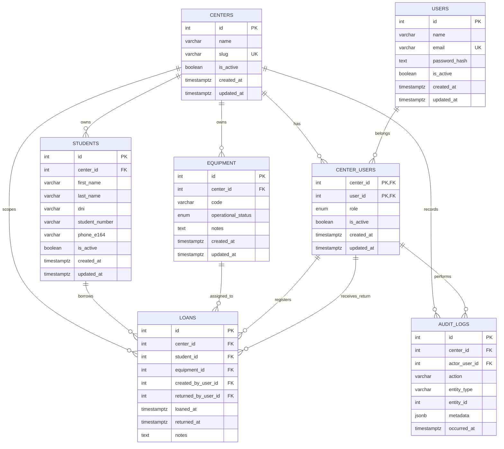

# Database design

PostgreSQL schema for MateControl, implemented with Prisma 7 in
`packages/database`.

`DB.md` (the raw design proposal) is local input and is not committed. This
document is the source of truth for the committed schema.

## Decisions

| Topic         | Decision                                             | Reason                                                                                                         |
| ------------- | ---------------------------------------------------- | -------------------------------------------------------------------------------------------------------------- |
| Student scope | Students belong to one center (`students.center_id`) | Avoids exposing DNI/phone across centers. `centers` still exists so the app can grow to multiple centers.      |
| Primary keys  | `Int` autoincrement                                  | Simple, JSON-safe in Nest/Next, and large enough for this domain.                                              |
| Phones        | One current `phone_e164` on `students`               | The SPEC only needs the current searchable phone. `audit_logs` records changes.                                |
| Active loans  | A student may have several                           | The one-loan policy is not required initially. It can be added later with a partial unique index.              |
| PII           | Plaintext DNI/phone with at-rest controls            | Uniqueness and phone search need equality. Field-level encryption would require blind indexes and is deferred. |
| Deletes       | No hard deletes for domain history                   | Use `is_active`/status columns; FKs are `ON DELETE RESTRICT`.                                                  |

## Entity-relationship model



## Tables

### `centers`

| Column                      | Type               | Notes             |
| --------------------------- | ------------------ | ----------------- |
| `id`                        | `integer` identity | PK                |
| `name`                      | `varchar(120)`     |                   |
| `slug`                      | `varchar(80)`      | Unique, lowercase |
| `is_active`                 | `boolean`          | Default `true`    |
| `created_at` / `updated_at` | `timestamptz(6)`   |                   |

### `users`

System accounts (center operators). A user can belong to more than one center.

| Column                      | Type               | Notes                           |
| --------------------------- | ------------------ | ------------------------------- |
| `id`                        | `integer` identity | PK                              |
| `name`                      | `varchar(120)`     |                                 |
| `email`                     | `varchar(255)`     | Unique, normalized to lowercase |
| `password_hash`             | `text`             | Never plaintext                 |
| `is_active`                 | `boolean`          | Default `true`                  |
| `created_at` / `updated_at` | `timestamptz(6)`   |                                 |

### `center_users`

Membership and role of a user inside a center.

| Column                      | Type             | Notes                 |
| --------------------------- | ---------------- | --------------------- |
| `center_id`                 | `integer`        | PK, FK → `centers.id` |
| `user_id`                   | `integer`        | PK, FK → `users.id`   |
| `role`                      | enum             | `admin` or `operator` |
| `is_active`                 | `boolean`        | Default `true`        |
| `created_at` / `updated_at` | `timestamptz(6)` |                       |

Index: `user_id` (to list a user's centers).

### `students`

Personal data, scoped to one center.

| Column                      | Type               | Notes                          |
| --------------------------- | ------------------ | ------------------------------ |
| `id`                        | `integer` identity | PK                             |
| `center_id`                 | `integer`          | FK → `centers.id`              |
| `first_name` / `last_name`  | `varchar(100)`     |                                |
| `dni`                       | `varchar(12)`      | Digits only; unique per center |
| `student_number`            | `varchar(40)`      | Legajo; unique per center      |
| `phone_e164`                | `varchar(16)`      | E.164; unique per center       |
| `is_active`                 | `boolean`          | Default `true`                 |
| `created_at` / `updated_at` | `timestamptz(6)`   |                                |

Unique: `(center_id, dni)`, `(center_id, student_number)`,
`(center_id, phone_e164)`, `(center_id, id)` (the last one is the target of the
composite loan FK).

Index: `(center_id, last_name, first_name)` for name search.

### `equipment`

One row per physical mate kit.

| Column                      | Type               | Notes                                  |
| --------------------------- | ------------------ | -------------------------------------- |
| `id`                        | `integer` identity | PK                                     |
| `center_id`                 | `integer`          | FK → `centers.id`                      |
| `code`                      | `varchar(30)`      | Unique per center                      |
| `operational_status`        | enum               | `in_service`, `maintenance`, `retired` |
| `notes`                     | `text`             | Optional                               |
| `created_at` / `updated_at` | `timestamptz(6)`   |                                        |

Unique: `(center_id, code)`, `(center_id, id)`.

Index: `(center_id, operational_status)`.

`loaned` is **not** stored. It is derived from an active row in `loans`.

### `loans`

A loan of one equipment to one student.

| Column                | Type               | Notes                                 |
| --------------------- | ------------------ | ------------------------------------- |
| `id`                  | `integer` identity | PK                                    |
| `center_id`           | `integer`          | Scope                                 |
| `student_id`          | `integer`          | Student registered in the same center |
| `equipment_id`        | `integer`          | Equipment owned by the same center    |
| `created_by_user_id`  | `integer`          | Operator who delivered                |
| `returned_by_user_id` | `integer`          | Operator who received the return      |
| `loaned_at`           | `timestamptz(6)`   | Default `now()`                       |
| `returned_at`         | `timestamptz(6)`   | `NULL` means active                   |
| `notes`               | `text`             | Optional                              |

Composite FKs:

- `(center_id, student_id)` → `students(center_id, id)`
- `(center_id, equipment_id)` → `equipment(center_id, id)`
- `(center_id, created_by_user_id)` → `center_users(center_id, user_id)`
- `(center_id, returned_by_user_id)` → `center_users(center_id, user_id)`

This makes cross-center loans impossible at the database level.

Indexes:

- Unique partial: `(center_id, equipment_id) WHERE returned_at IS NULL`.
  Guarantees one active loan per equipment, even under concurrency.
- Partial: `(center_id, loaned_at DESC) WHERE returned_at IS NULL` for active
  loan lists.
- `(center_id, student_id, loaned_at DESC)` for student history.
- `returned_by_user_id` for operator history.

### `audit_logs`

Relevant operations, without PII.

| Column          | Type               | Notes                               |
| --------------- | ------------------ | ----------------------------------- |
| `id`            | `integer` identity | PK                                  |
| `center_id`     | `integer`          | FK → `centers.id`                   |
| `actor_user_id` | `integer`          | Nullable; must belong to the center |
| `action`        | `varchar(60)`      | e.g. `loan.created`                 |
| `entity_type`   | `varchar(60)`      | e.g. `loan`                         |
| `entity_id`     | `integer`          | Nullable                            |
| `metadata`      | `jsonb`            | Default `{}`; no DNI/phone          |
| `occurred_at`   | `timestamptz(6)`   | Default `now()`                     |

Indexes: `(center_id, occurred_at DESC)`, `(entity_type, entity_id)`,
`actor_user_id`.

## Integrity rules

### Enforced by the database

| Rule                                          | Mechanism                                                       |
| --------------------------------------------- | --------------------------------------------------------------- |
| One active loan per equipment                 | Partial unique index                                            |
| A loan cannot mix centers                     | Composite foreign keys                                          |
| A student must belong to the loan's center    | Composite FK to `students`                                      |
| An equipment must belong to the loan's center | Composite FK to `equipment`                                     |
| Operators must belong to the loan's center    | Composite FK to `center_users`                                  |
| A returned loan must have a return operator   | `CHECK ((returned_at IS NULL) = (returned_by_user_id IS NULL))` |
| Return cannot precede delivery                | `CHECK (returned_at IS NULL OR returned_at >= loaned_at)`       |
| DNI format                                    | `CHECK (dni ~ '^[0-9]{7,9}$')`                                  |
| Phone format                                  | `CHECK (phone_e164 ~ '^\+[1-9][0-9]{7,14}$')`                   |
| Unique DNI/legajo/phone per center            | Unique constraints                                              |
| Unique email and center slug                  | Unique constraints                                              |

### Enforced by the application

| Rule                                                                            | Where                                                      |
| ------------------------------------------------------------------------------- | ---------------------------------------------------------- |
| Equipment must be `in_service` to lend                                          | Loan service transaction, after `SELECT ... FOR UPDATE`    |
| A returned loan cannot be reactivated                                           | Return service uses `UPDATE ... WHERE returned_at IS NULL` |
| Only `returned_at`, `returned_by_user_id` and `notes` may change after creation | Loan service                                               |
| A user must be active in the center to operate                                  | Auth/authorization guard                                   |
| Audit metadata must not contain DNI/phone                                       | Audit helper and code review                               |

## Concurrency

Loan creation must run in a transaction:

1. `SELECT ... FROM equipment WHERE center_id = $1 AND id = $2 FOR UPDATE`
2. Verify `operational_status = 'in_service'`.
3. Insert the loan.
4. Map a unique violation (`P2002`) to a `409 Conflict`.

The partial unique index is the final guarantee if two operators race.

Returning must be idempotent:

```sql
UPDATE loans
SET returned_at = now(), returned_by_user_id = $3
WHERE id = $1 AND center_id = $2 AND returned_at IS NULL
RETURNING *;
```

Zero rows means the loan was already returned or does not belong to the center.

## Migration workflow

Prisma 7 supports partial indexes behind the `partialIndexes` preview feature.
They are declared in `schema.prisma` with `where: { returnedAt: null }`.

CHECK constraints are not representable in Prisma schema. They are appended to
the generated migration SQL:

```bash
pnpm db:migrate -- --name init --create-only
# edit prisma/migrations/<timestamp>_init/migration.sql
pnpm db:migrate
```

Rules:

- Do not use `prisma db pull` as the source of truth; it does not preserve the
  hand-written CHECK constraints.
- Re-check `pg_indexes` and `pg_constraint` after changing the schema.
- Run `prisma migrate reset` to prove the migration chain replays cleanly.
- Run `prisma migrate diff` in CI once a CI pipeline exists.

## Seed and tests

- `pnpm db:seed` creates/updates the default center (idempotent).
- `pnpm db:test:setup` creates `mate_control_test`.
- `TEST_DATABASE_URL` points to the test database.
- Database tests migrate the test database, truncate between tests, and run
  serially. They cover the constraints above, including the concurrent loan
  race.

## Future work

- Global student identity across centers, with explicit consent.
- Phone history and multiple phones.
- Loan due dates, extensions, and overdue tracking.
- Field-level encryption with blind indexes for DNI/phone.
- Audit retention and student anonymization policy.
- Optional one-active-loan-per-student policy per center.
